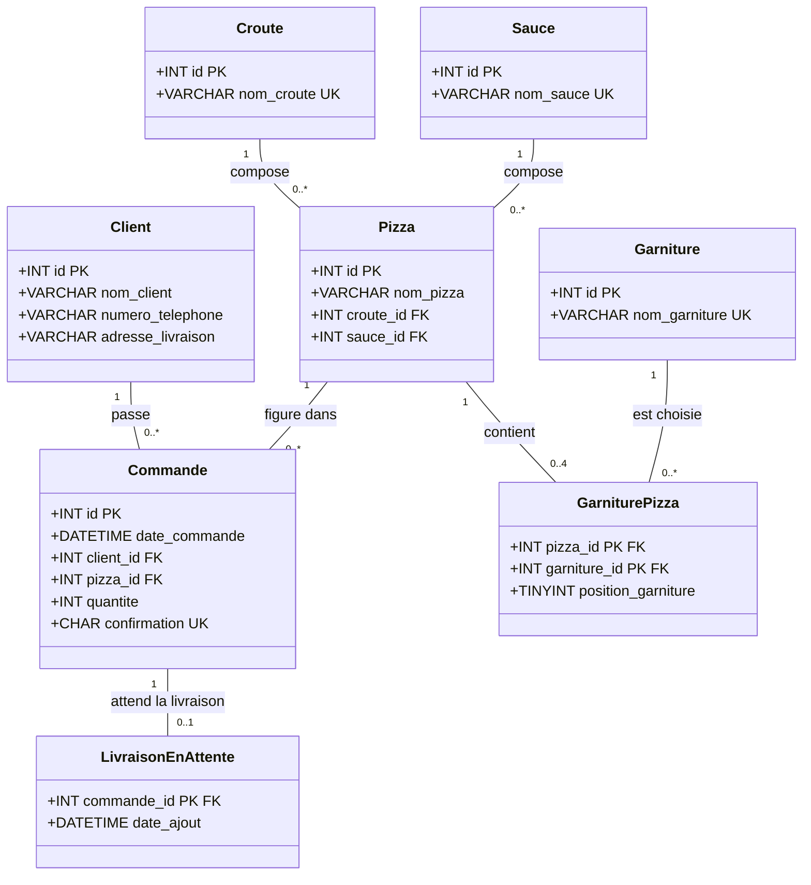

# Diagramme de classes de la pizzeria

`PK` indique une clé primaire, `FK` une clé étrangère et `UK` une valeur unique.

- Chaque commande référence une seule pizza. `quantite` indique le nombre d’exemplaires identiques et doit être supérieure à zéro.
- Une pizza a une croûte, une sauce et jusqu’à quatre garnitures distinctes. Dans `garnitures_pizza`, une position entre 1 et 4 ne peut être utilisée qu’une fois par pizza.
- Le déclencheur `trg_commande_en_attente` crée l’entrée de livraison lors de l’insertion d’une commande. Quand la livraison est complétée, l’entrée sort de la file et la commande reste en base.
- La colonne `confirmation` contient le jeton utilisé par Flask pour empêcher un double enregistrement. Les commandes migrées peuvent avoir un jeton `NULL`.
